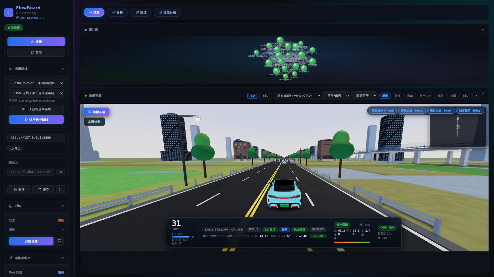
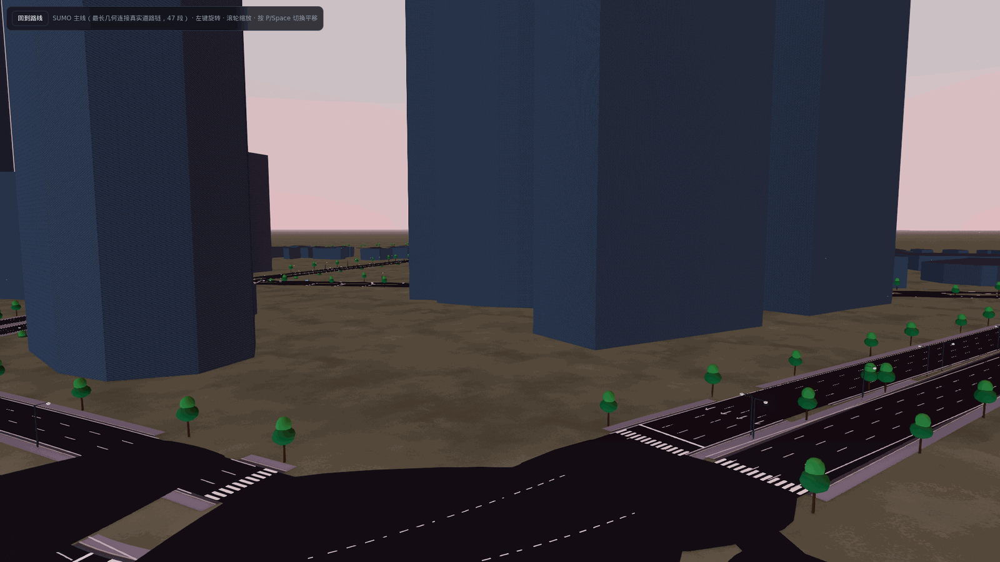
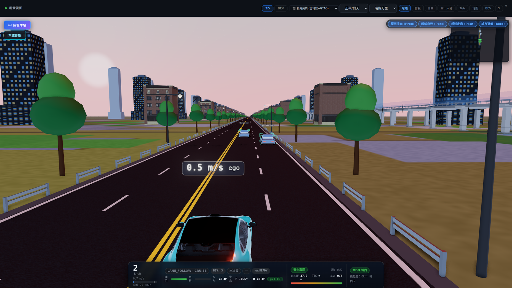
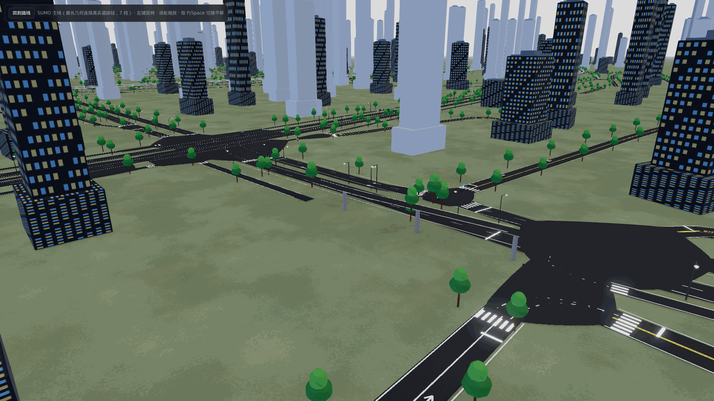
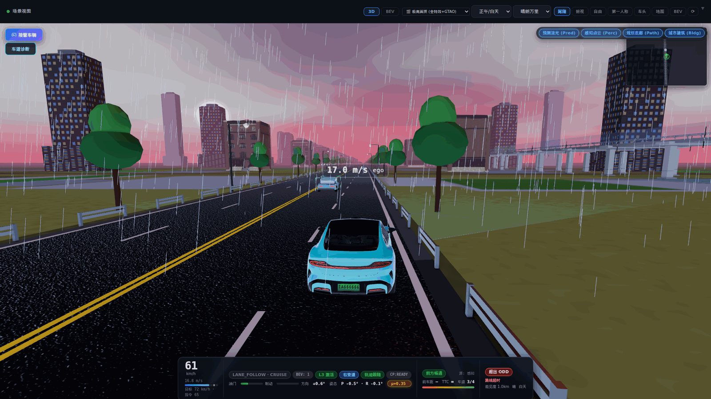

# KunAutoDrive

> 面向自动驾驶与机器人的仿真优先全栈中间件与数字孪生平台：零第三方中间件依赖的 C11 内核、C++20/FlowCoro 协程插件管线、M1–M6 感知-预测-规划-控制-6DOF 物理闭环，以及城市级 OSM 高精地图 3D 实时数字孪生。

[](https://github.com/caixuf/kunautodrive/actions)


**体量速览**：C 内核与节点 ~6.8 万行 · C++ ADAS 节点 ~3.2 万行 · Python 工具链/评估器/生态桥接 ~4.7 万行 · 手写前端 3D 数字孪生 ~2.5 万行（52 个无框架 ES modules）；默认管线 **20 节点**（L3 sensor / 车端编排 19 节点）；**20+ 条**静态/运行时门禁 + **6 组 46 项**前端门禁 + **53 项** CTest + **38 个**仿真场景 / **8 张**高精地图；配套 **7 部 26 章**技术专著（[docs/BOOK.md](docs/BOOK.md)）。

## 实机演示与多场景数字孪生

<!--
  截图约定：docs/screenshots/*.png 全部来自真实 FlowBoard / SceneDirector 渲染（1600x900 16:9，单张 < 1.2MB），
  严禁使用占位图或伪造遥测。
-->

<p align="center">
  
</p>
<p align="center">
  <sub><b>FlowBoard 实时全栈驾驶舱</b>：上方为 20 节点消息总线实时拓扑流，下方为小米 SU7 PBR 座舱跟车视角、SR 3D 感知角框、多模态预测丝带、小地图与全量驾驶态势 HUD（<code>http://localhost:8800</code>）。</sub>
</p>

<table>
  <tr>
    <td width="50%" align="center">
      <br>
      <sub><b>城市级 OSM 车道级大图（陆家嘴）</b><br>8m 物理尺度无缝沥青 PBR、花岗岩路缘石与人行道、斑马线/导流弧线及 3D 城市天际线</sub>
    </td>
    <td width="50%" align="center">
      <br>
      <sub><b>SR 世界模型：多模态预测与加塞预警</b><br>3D 八角感知框、LiDAR 轮廓扫描点、Frenet 三模态预测丝带（LK / Cut-In / Yield）与双 V 加塞警示纹</sub>
    </td>
  </tr>
  <tr>
    <td width="50%" align="center">
      <br>
      <sub><b>多层高架立交与跨线桥</b><br>高程分层桥面板与混凝土防撞护栏、地面渠化交叉口及周边 3D 建筑群同屏渲染</sub>
    </td>
    <td width="50%" align="center">
      <br>
      <sub><b>全天候湿滑路面与 6-DOF 雨幕渲染</b><br>黄昏降雨近光灯束、<code>μ = 0.35</code> 湿滑摩擦区镜面反光、后轮水雾尾迹与主动变道避险</sub>
    </td>
  </tr>
</table>

## 先看这里

KunAutoDrive 是**仿真优先、可复现、可度量**的自动驾驶实验与集成平台：感知、预测、融合、规划、控制与学习算法先在闭环仿真中运行、回放、回归评分与故障注入验证，再迁移至硬件平台（当前内置 RC 小车部署 profile；乘用车量产认证不在承诺范围内）。

| 你想做什么 | 从这里开始 |
|---|---|
| 一键跑起 20 节点全栈仿真与 3D 驾驶舱 | [快速开始](#快速开始) |
| 了解 M1–M6 次世代全栈核心能力 | [M1–M6 全栈核心能力](#m1m6-全栈核心能力) |
| 用键盘接管车辆、诊断轮向/车灯/动力学 | [游戏诊断模式](#游戏诊断模式) |
| 了解 SAE L3 安全闭环（ODD/TOR/MRM/故障注入/EDR/R157） | [L3 安全闭环](#l3-安全闭环) |
| 部署到 RC 小车或 Windows 原生环境 | [车辆部署](#车辆部署) |
| 记录并分析 PEM 车端数据 | [PEM 数据闭环](#pem-数据闭环) |
| 修改算法/前端并执行门禁回归 | [验证与 CI](#验证与-ci) |
| 系统性阅读架构与 26 章专著 | [架构](#架构) · [技术专著](#技术专著与实战教程book) · [核心文档](#核心技术文档) |

## M1–M6 全栈核心能力

- **纯 C11 / C++20 零第三方中间件内核**：自研进程内零拷贝 `message_bus`、统一 `transport`（local / POSIX SHM / 跨机紧凑帧 TCP）、`scheduler`（classic / choreo DAG 绑核限频）、`FlowCoro` C++20 栈无关协程、反射式状态机、参数热重载，以及单二进制监控守护进程 `flowmond`（HTTP + SSE + IPC/文件双桥接），原生支持 **Linux** 与 **Windows（MinGW-w64）**。
- **M1 · 3D 点云与纯 C BEV 感知**：16 线 3D OBB 射线投射激光雷达模型（`lidar_3d.h`）+ 6 通道 BEV 特征栅格化 + 纯 C 零外部推理库依赖的 `CenterPoint-Lite` 卷积检测头（`bev_cnn_native.c`）+ 车道线三次多项式拟合。
- **M2 · 全局最优跟踪与多模态轨迹预测**：64 槽位 Kuhn-Munkres 匈牙利全局最优关联 EKF 多目标跟踪（`hungarian_tracker.h`）+ Frenet 坐标系三模态意图与轨迹预测（`lane_keep` / `cut_in` / `yield_decel`）+ ST 图消费切入模态预减速。
- **M3 · 场景化规划、Hybrid A* 代客泊车与控制**：`ScenarioManager` 统一调度巡航跟车/变道（`LaneFollowScenario`：Frenet 横向 + 90×101 DP ST 图速度规划）与开放空间泊车（`ValetParkingScenario`：Hybrid A* + Reeds-Shepp 解析末端生成 64 点保换挡尖点正/倒车轨迹），配合 Stanley / 可选 LTV MPC + `ManeuverTracker` D/R 换挡闭环及 SAE L3 ODD/TOR/MRM/EDR 安全链路。
- **M4 · 6-DOF 车辆动力学与多车交互交通流**：`flowsim` 支持二阶弹簧阻尼簧载悬架（俯仰 `pitch` / 侧倾 `roll`）、纵向载荷转移 $\Delta F_z$、道路坡度重力分量补偿、局部路面摩擦系数区 `friction_zones`（湿滑 $\mu=0.35$ / 结冰路面）以及 IDM + MOBIL 多 OD 智能交通流。
- **M5 · 次世代 3D 数字孪生与城市级 OSM 大图**：Three.js r160 PBR 渲染管线（GTAO 环境光遮蔽 + Bloom 辉光 + SMAA 抗锯齿 + 4096 PCF 软阴影）、小米 SU7 meshopt 模型（主销转向 + 簧载俯仰/侧倾联动）、SR 世界模型（3D 八角感知框、LiDAR 轮廓扫描点、单批次 3D 多模态预测丝带、地面双 V 加塞警示纹），以及权威 OSM 车道级高精地图渲染（`osm_munich`、`osm_lujiazui_v2`、`beijing_guomao`、`osm_zhengdong` 1.2 万路段走廊裁剪 ~130 万三角面预算，含 8m 物理尺度沥青纹理、花岗岩路缘石/人行道、无缝渠化路口与多层高架立交）。
- **M6 · 标准生态桥接与 CI 治理门禁**：OpenDRIVE 1.4 三维高程/超高/路面材质导出与静态兼容性预检（`json_to_xodr.py` + `xodr_compat_check.py`）、Lanelet2 导出与几何一致性门禁（`json_to_lanelet.py`）、CARLA 6-DOF 双向联合仿真桥（`carla_bridge.py`）、Foxglove Studio WebSocket 桥接（`foxglove_bridge.py`），以及 20+ 项 CI 治理门禁。

## 快速开始

```bash
git clone https://github.com/caixuf/kunautodrive.git
cd kunautodrive

# 一键构建并启动 20 节点默认仿真；浏览器打开 http://localhost:8800
bash scripts/demo.sh

# CI / 无头环境指定场景与时长运行
bash scripts/demo.sh --scenario scenarios/urban_challenge.json --no-browser 30
```

运行后可通过浏览器访问三大前端入口（统一复用同一套 `tools/flowboard/js/vis/` 3D 引擎）：
- **实时全栈驾驶舱**：`http://localhost:8800`（连接实时管线、20 节点拓扑、小地图、参数热调与接管诊断）
- **38 场景离线展厅**：`http://localhost:8800/tools/flowboard/showcase.html`（无需后端算力即可秒切全部 38 个场景并自由切换光照/雨雾天气）
- **OSM 高精大图预览器**：`http://localhost:8800/tools/flowboard/map_preview.html?map=osm_lujiazui_v2&route=main`（支持 `osm_lujiazui_v2`、`osm_munich`、`beijing_guomao`、`osm_zhengdong` 等 8 张地图）

常用运行与调试命令：

```bash
bash scripts/demo.sh --scenario scenarios/valet_parking.json --no-browser 30   # Hybrid A* 代客泊车
bash scripts/demo.sh --scenario scenarios/wet_road_evasion.json --no-browser 30 # 湿滑路面摩擦区避险
bash scripts/demo.sh --record                                                   # 录制 Bag v2 / MCAP
bash scripts/demo.sh --multi                                                    # 多进程 POSIX SHM 模式
./build/bin/flowctl list                                                        # 查看运行中节点与 Topic
./build/bin/flowctl param set control.k_vy 0.40                                 # 运行时热重载控制参数
```

## 游戏诊断模式

运行 demo 后，点击 FlowBoard 左上角的 **🎮 接管车辆**：

- 使用 `WASD` 或方向键直接控制车辆，`R` 键切换 `D ↔ R` 挡位；再次点击即可平顺交还自动驾驶。
- 游戏 HUD 内支持一键或快捷键（`L/Q/E/H`）切换近光灯、左/右转向灯与双闪，`S/↓` 或空格测试刹车灯联动。
- 实时对比转向输入、前轮主销转角、车身航向与实际速度矢量偏差，快速定位物理积分或航位推算问题。
- 偏离道路时点击**回到车道**，将自车安全复位至最近车道中心线。

仿真统一遵循右手 ENU 约定：`steer > 0` 为左转（heading / y 增大），`steer < 0` 为右转。

## 架构

```text
flowsim (6-DOF + IDM/MOBIL) -> sensor_model (16-beam LiDAR / Radar / GPS)
  -> perception + bev_detection (CenterPoint-Lite) + lane_detection
  -> object_tracker (Hungarian EKF) -> prediction (3-Modal Frenet) + fusion (EKF)
  -> behavior_planner + navigation -> planning (ScenarioManager: Frenet+DP / Hybrid A*)
  -> control (Stanley / LTV-MPC / ManeuverTracker) -> safety_control (FlowCoro TTC/MRM)
  -> odd_monitor + tor_manager + monitor -> flowmond (:8800) -> FlowBoard 3D / PEM / Bridges
                                                |
                                                +-> data_recorder -> learner / train -> inference -> model_ota
```

| 层级 | 关键模块与能力 |
|---|---|
| **C11 内核** | `message_bus` 零拷贝 Pub/Sub、`transport`（local/SHM/TCP）、`scheduler`、时钟、参数热重载、IDL 序列化 |
| **C++20 外壳** | `FlowCoro` 协程节点、`NodePlugin` 动态加载、反射状态机、UDP 服务发现、健康心跳 |
| **M1–M4 算法与仿真** | `flowsim` 6-DOF 物理、16 线 LiDAR、纯 C BEV CNN、匈牙利跟踪、三模态预测、Frenet+ST DP、Hybrid A* 泊车、L3 安全闸门 |
| **M5 3D 数字孪生** | `flowmond` 守护进程、52 模块 Three.js r160 PBR 引擎、SU7 模型、SR 世界模型、OSM 城市级车道大图 |
| **M6 闭环与生态** | Bag/MCAP、PEM 遥测、影子推理/DAgger/PPO/OTA、OpenDRIVE 1.4 / Lanelet2 / CARLA 6-DOF / Foxglove 桥接 |

详细架构见 [算法栈全景](docs/ALGORITHM_STACK.md)、[管线架构](docs/PIPELINE_ARCHITECTURE.md)、[可视化架构](docs/VISUALIZATION_ARCHITECTURE.md)、[监控架构](docs/MONITORING_ARCHITECTURE.md) 与 [数据闭环](docs/DATA_CLOSED_LOOP.md)。

## L3 安全闭环

项目在中间件与算法栈之上构建了完整的 SAE L3 安全闭环，全部由带反向故障注入校验的 CI 门禁锁定：

| 能力 | 内容 | 验证门禁 |
|------|------|------|
| ODD / TOR / MRM | 运行设计域实时监控 → 接管请求倒计时 → 最小风险机动（MRM 真停；遥测缺失判 `INCONCLUSIVE` 而非伪 `PASS`） | `ctest -R tor_mrm_sim` + `l3_odd_exit_*` 场景 |
| 6 类故障注入 | 定位丢失 / 感知丢失 / 规划丢失 / 原始指令超时 / GPS 单源退化 / 全源丢失，每类具备可观测降级证据 | `ci/gates/fault_inject_gate.py`（6/6） |
| 降级阶梯 + 看门狗 | L1/L2/L3 单调降级、多节点心跳表与超时保护 | `ctest -R safety_fault_evidence` |
| 定位冗余校验 | GPS 与航位推算交叉一致性检验，单源瞬断不误触发全链路瘫痪 | `tools/localization_integrity_sim.py --run-all` |
| 传感器线格式契约 | 16 线 LiDAR 与毫米波雷达量程/FOV/径向速度模型，IDL 线格式与 C 结构体逐字节对齐 | `ctest -R "adas_nodes_logic\|new_module"` |
| EDR 法规事件黑匣子 | L3 关键事件（激活/退出/TOR/MRM/ODD 退出/碰撞）带 CRC + `fsync` 落盘 PEM | `ci/gates/l3_edr_gate.py` |
| UN R157 (ALKS) 场景集 | 旁车切入/切出/前车急刹/施工区收窄/传感器失效等法规场景矩阵 | `scenario_regression.py --baseline`（23 场景基线门禁） |

历史疑难根因沉淀见 [故障模式表](docs/FAILURE_MODES.md)（96 行「现象 → 根因 → 代码位置」），安全论据见 [L3 Safety Case](docs/SAFETY_CASE_L3.md) 与 [L3 Roadmap](docs/ROADMAP_L3.md)。

## 车辆部署

| Profile | 配置文件 | 用途 |
|---|---|---|
| `simulation` | `config/pipeline.json`（20 节点） / `config/pipeline_sensor.json`（19 节点） | 默认闭环仿真、传感器链路验证与 3D 驾驶舱开发 |
| `rc_car` | `config/pipeline_car.json`（19 节点） | 面向 GPS/IMU/激光雷达/PWM 或 SocketCAN 执行器的 RC 小车实车模板 |

打包可部署产物：

```bash
bash scripts/deploy.sh --package
```

接线、执行器标定与上车前核查见 [RC 小车硬件清单](docs/RC_CAR_HARDWARE_CHECKLIST.md)。

### Windows 原生运行

支持 Windows 原生单进程插件管线（CMake + Ninja + WinLibs MinGW-w64 GCC 11+ + Python）：

```powershell
git clone https://github.com/caixuf/kunautodrive.git
cd kunautodrive
git submodule update --init --depth 1 third_party/esmini
powershell -ExecutionPolicy Bypass -File scripts\demo.ps1 -Duration 30
```

详见 [硬件部署指南](docs/HARDWARE_DEPLOYMENT.md)（Linux → Windows 交叉编译工具链位于 `cmake/mingw-w64-x86_64.cmake`）。

## PEM 数据闭环

`config/pipeline_car.json` 的 production 模式自动启用双流 PEM 车端持久化遥测：

- `monitor_node`：记录系统资源、Topic 吞吐/延迟、健康心跳与降级事件。
- `pem_collector_node`：通过 `FlowCoro` 异步采集定位里程、行驶时长、区域迁移与 L3 安全事件。

两条流均内置 CRC 校验、关键事件强制 `fsync`、按时间/体积滚动切片与目录配额清理：

```bash
python3 tools/pem_dump.py /tmp/kunautodrive_pem_*.pem
python3 tools/pem_dump.py --jsonl --type business /tmp/kunautodrive_pem_business_*.pem
env -u LD_LIBRARY_PATH ctest --test-dir build --output-on-failure -R pem_runtime_smoke
```

## 验证与 CI

修改代码后按模块选择对应门禁（完整流水线定义于 `.github/workflows/ci.yml`，共 23 个 CI Job）：

```bash
# 1. C/C++ 单元与集成测试（53 项 CTest）
env -u LD_LIBRARY_PATH ctest --test-dir build --output-on-failure

# 2. 离线管线契约与架构静态门禁（秒级）
python3 tools/pipeline_check.py
python3 ci/gates/zombie_ban_check.py
python3 ci/gates/book_guard.py

# 3. 45 秒闭环运行时行为评估与 23 场景回归基线
python3 ci/evaluators/demo_evaluator.py --duration 45 --interval 0.5
python3 ci/evaluators/scenario_regression.py --baseline

# 4. OpenDRIVE / Lanelet2 高精地图导出与兼容性门禁
python3 tools/xodr_compat_check.py maps/osm_munich/map.xodr --strict

# 5. FlowBoard 3D 前端全量门禁（6 组共 46 个测试文件 + showcase 同步检查）
npm run vis:check:all
python3 tools/build_showcase.py --check
```

## 文档导航

完整的中文模块导航、权威文档单一事实源（Single Source of Truth）归属见 **[docs/README.md](docs/README.md)**，按主题速查索引见 **[docs/INDEX.md](docs/INDEX.md)**。

## 技术专著与实战教程（book/）

《KunAutoDrive：从零构建高性能自动驾驶系统与仿真引擎》（全书共 **第零至第六部、26 章**，完整导读见 [docs/BOOK.md](docs/BOOK.md)）：

| 部分 | 主题 | 包含章节 |
|------|---------|---------|
| **第零部** | 先跑起来 | [00 前言](docs/book/00_preface.md) · [00b 构建、演示与 pipeline.json](docs/book/00b_run_pipeline.md) |
| **第一部** | 框架骨架 | [01 用 C 造对象](docs/book/01_oop_in_c.md) · [02 可插拔 .so](docs/book/02_plugin_system.md) · [03 注册中心与参数](docs/book/03_registry_and_params.md) · [04 状态机](docs/book/04_state_machine.md) |
| **第二部** | 通信与时间 | [05 消息总线](docs/book/05_message_bus.md) · [06 序列化与 IDL](docs/book/06_serializer.md) · [07 共享内存 IPC](docs/book/07_ipc_channel.md) · [08 服务发现](docs/book/08_discovery.md) · [09 时钟服务](docs/book/09_clock_service.md) |
| **第三部** | 执行与调度 | [10 C++20 协程](docs/book/10_coroutine.md) · [11 调度器与绑核](docs/book/11_scheduler.md) |
| **第四部** | 录制与回放 | [12 Bag、MCAP 与 flowrec](docs/book/12_bag_recording.md) |
| **第五部** | ADAS 算法栈 | [13 点云聚类与跟踪](docs/book/13_lidar_tracking.md) · [14 定位融合 EKF](docs/book/14_sensor_fusion.md) · [15 行为决策](docs/book/15_behavior_decision.md) · [16 Frenet 轨迹规划](docs/book/16_trajectory_planning.md) · [17 跟踪控制与 MPC](docs/book/17_tracking_control.md) · [18 安全包络与降级](docs/book/18_safety_envelope.md) · [19 执行器 PWM / SocketCAN](docs/book/19_socketcan_actuator.md) |
| **第六部** | 仿真、可视化与学习闭环 | [20 FlowSim 场景设计](docs/book/20_flowsim_scenario_design.md) · [21 VLA 与世界模型前沿](docs/book/21_vla_world_model_frontier.md) · [22 flowmond 3D 监控](docs/book/22_flowmond_3d_vis.md) · [23 黑盒回归评估](docs/book/23_demo_evaluator.md) · [24 端到端学习闭环](docs/book/24_e2e_learning_loop.md) |

---

## 核心技术文档

| 文档 | 主题 |
|-----|-------|
| [Algorithm Stack](docs/ALGORITHM_STACK.md) | M1–M6 算法栈全景（各模块真实算法 × 源码文件对照） |
| [Pipeline Architecture](docs/PIPELINE_ARCHITECTURE.md) | 20 节点插件管线设计与 Topic 拓扑 |
| [Code Wiki](docs/CODE_WIKI.md) | 源码架构、20 节点职责与控制子系统深度解析 |
| [FlowSim Physics](docs/FLOWSIM_PHYSICS.md) | 6-DOF 簧载悬架动力学、载荷转移、局部摩擦区与碰撞稳定性 |
| [Visualization Architecture](docs/VISUALIZATION_ARCHITECTURE.md) | `flowmond` + 52 模块 `vis/` 架构树与图层体系 |
| [3D Rendering Pipeline](docs/VIS_3D_RENDERING.md) | Three.js r160 PBR、SU7 模型、SR 感知世界模型与天气特效 |
| [3D Lane & OSM Pipeline](docs/VIS_3D_LANE_PIPELINE.md) | OSM 车道级路网几何、8m 物理沥青 UV、渠化路口与高架立交管线 |
| [FlowBoard Scene Contract](docs/FLOWBOARD_SCENE_CONTRACT.md) | `metrics.scene` v2.2 前后端 3D 场景数据契约 |
| [Simulation Guide](docs/SIMULATION_GUIDE.md) | 38 场景仿真测试与生态桥接指南 |
| [Safety Case L3](docs/SAFETY_CASE_L3.md) | SAE L3 安全保证论据（ODD / TOR / MRM / 故障注入 / EDR） |
| [Failure Modes](docs/FAILURE_MODES.md) | 96 行历史疑难故障「现象 → 根因 → 位置」权威速查表 |
| [API Quick Reference](docs/API_QUICK_REFERENCE.md) | C11 / C++20 核心 API 速查 |
| [Hardware Deployment](docs/HARDWARE_DEPLOYMENT.md) | Linux / Windows / 交叉编译与硬件部署指南 |
| [Learning Loop](docs/LEARNING_LOOP.md) | 车端数据采集、模仿学习/RL 训练、影子推理与 OTA 闭环 |

---

## 许可证

MIT License. 产品与仓库名称为 **KunAutoDrive**。`FLOWENGINE_*`、`flowengine_core` 和 `libflowengine_*` 等保留为底层 ABI/API 兼容标识符。
